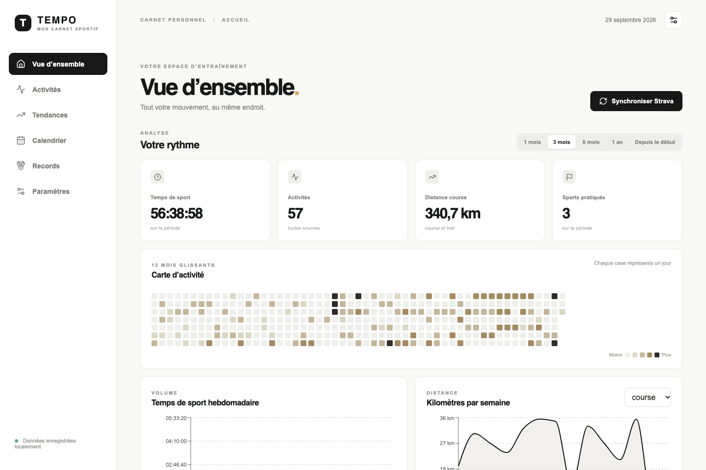

# Tempo — mon carnet sportif

Tempo rassemble vos activités sportives dans une application locale, en français. Vous pouvez consulter vos séances, suivre votre volume d’entraînement, préparer les prochaines et retrouver vos records à partir des données disponibles.



## À quels besoins répond Tempo ?

| Besoin | Dans Tempo |
| --- | --- |
| Retrouver toutes ses séances | Un journal avec recherche, filtres, détails et étiquettes personnelles. |
| Comprendre son activité dans le temps | Une carte des jours actifs, des graphiques hebdomadaires et des tendances par sport. |
| Préparer ses entraînements | Un calendrier avec séances prévues, objectifs datés et comparaison avec les activités réalisées. |
| Garder des repères | La plus longue sortie à pied, à vélo ou en natation, et les meilleurs efforts calculables à partir de fichiers FIT. |
| Suivre son ressenti | Une saisie manuelle du sommeil, de la VFC et de notes quotidiennes. |

Les données restent dans une base SQLite sur votre ordinateur. Tempo est prévu pour un seul utilisateur et doit être utilisé en local : il ne propose pas d’authentification.

## Comment l’utiliser

### 1. Installer et démarrer

Prérequis : **Python 3.11+** et **Node.js 22.12+** (ou 20.19+).

Depuis la racine du projet, lancez :

```bash
./start.sh
```

Au premier lancement, le script crée `.env` et l’environnement Python, installe les dépendances, puis applique les migrations de la base. Il démarre ensuite l’API et l’interface dans le même terminal. Utilisez **Ctrl+C** pour arrêter les deux serveurs.

Ouvrez [http://127.0.0.1:5173](http://127.0.0.1:5173). La documentation de l’API est disponible sur [http://127.0.0.1:8000/docs](http://127.0.0.1:8000/docs).

Si ces ports sont déjà utilisés, choisissez-en d’autres avec `BACKEND_PORT=8001 FRONTEND_PORT=5174 ./start.sh`.

### 2. Ajouter des activités

Dans **Paramètres**, importez des fichiers `.fit` ou une archive ZIP contenant des FIT. L’application signale les doublons et affiche le résultat de chaque import.

Vous pouvez aussi connecter Strava : renseignez `STRAVA_CLIENT_ID` et `STRAVA_CLIENT_SECRET` dans `.env`, créez une application Strava dont le domaine de callback est `localhost`, puis utilisez **Connecter Strava** et **Synchroniser** dans Paramètres. L’URI de retour attendue est `http://localhost:8000/api/strava/callback`. Une synchronisation ultérieure met à jour les activités sans écraser vos corrections locales.

Pour essayer Tempo sans importer vos activités, chargez les données de démonstration :

```bash
cd backend && ../.venv/bin/python seed.py
```

Ces activités portent la source `demo` et peuvent être distinguées des autres dans le journal.

### 3. Explorer et organiser

- **Vue d’ensemble** : choisissez une période et survolez les cases de la carte pour lire la durée correspondant à leur couleur.
- **Activités** : recherchez une séance, filtrez par sport ou date, puis ouvrez sa fiche pour modifier son nom, son sport ou ses étiquettes.
- **Tendances** : comparez l’allure, la fréquence cardiaque, le dénivelé et la durée des séances ayant une distance enregistrée. Les sports sans kilomètres restent visibles dans le graphique de temps hebdomadaire.
- **Calendrier** : ajoutez une séance prévue, associez-la à une activité réalisée et notez votre sommeil ou votre VFC.
- **Records** : consultez les plus longues distances. Les records sur 5 km, 10 km et autres distances de course nécessitent des points FIT horodatés ; un simple résumé d’activité ne suffit pas.

Les durées sont affichées en `hh:mm:ss` et l’allure en `min/km`. Le sommeil et la VFC sont des notes personnelles, sans interprétation médicale.

**À savoir :** cette version inclut les activités issues de l’API Strava dans les graphiques. La [politique API Strava, section 5.4](https://www.strava.com/legal/api_policy) interdit l’analyse et l’agrégation de ces données. Pour un usage conforme à cette politique, utilisez des fichiers FIT issus de votre export personnel et retirez les données API Strava des calculs.

## Choix techniques

**React et TypeScript** organisent l’interface en pages et composants typés ; **Vite** accélère le développement local. **FastAPI** expose les données au frontend, tandis que **SQLAlchemy et Alembic** gèrent les modèles et leurs évolutions. **SQLite** évite d’installer un serveur de base de données pour cet usage personnel. **Recharts** affiche les graphiques à partir des calculs du backend.
